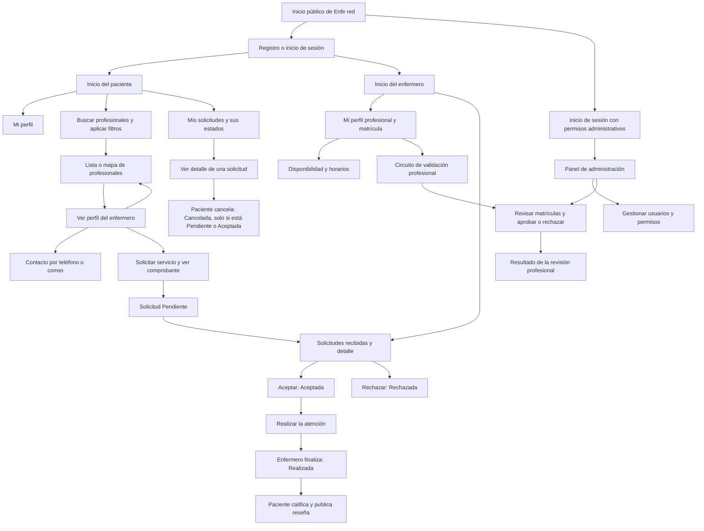

# Mapa de navegación de Enfe red

El mapa compartido por Pablo para otra materia sirve como base del recorrido
general de la aplicación: paciente, enfermero y administrador tienen funciones
distintas y se conectan mediante las solicitudes de atención.

Se conserva como referencia para continuar, incorporando los ajustes de esta
revisión. Describe el flujo objetivo, con funciones actuales y futuras; no es
un inventario de pantallas ya implementadas ni agrega tareas al sprint vigente.
Fuente: imagen compartida por Pablo. Revisión del 15/10/2026 sobre `Prueba`.

## Recorrido de referencia

El diagrama reconstruye la idea del mapa y agrega inicio de sesión del enfermero
y administrador, acceso a perfiles y solicitudes, rechazo, cancelación y
finalización. Los pasos de servicio son acciones del proceso, no necesariamente
pantallas distintas. Los nodos de administración, solicitudes y reputación deben
leerse junto con su estado de implementación en la tabla siguiente.

Los accesos por rol representan el destino autorizado después de autenticarse,
no una selección que permita obtener permisos. La cuenta administrativa no se
crea desde el registro público de pacientes/enfermeros.

## Estado frente a la aplicación actual

| Parte del recorrido | Estado al revisar Prueba | Cómo continuar |
| --- | --- | --- |
| Registro, login y perfiles propios | Implementado para paciente y enfermero. | Conservar `AuthLayout`, `AppShell` y `ProfileEditor`. |
| Búsqueda, lista, mapa y perfil profesional | Implementado con filtros actuales y mapa. | Mantener retorno con filtros. Filtrar por valoración, servicio del catálogo y cercanía real requiere trabajo adicional; no asumir que ya existe. |
| Contacto por teléfono/correo | Implementado en el perfil profesional. | Conservarlo mientras se integra el flujo de solicitudes. |
| Disponibilidad y horarios | Disponibilidad general y alta/consulta de franjas implementadas. | Edición y eliminación de franjas no están implementadas. |
| Crear, consultar y gestionar solicitudes | Backend de Santiago y Pablo integrado. | Falta integrar formulario, comprobante, bandejas y acciones del frontend del Sprint 4. |
| Calificaciones y reseñas | Pendiente. | Solo permitir calificar después de que la solicitud esté Realizada; respetar la entrega del 02/11. |
| Administración y validación profesional | Las rutas protegidas y las vistas de usuarios/métricas están integradas en el frontend; requieren los endpoints administrativos de Pablo para operar. | No permitir acceso por selección de rol en registro. La primera cuenta administradora debe habilitarse fuera del registro público. |
| Subir títulos o documentos | No hay carga de archivos implementada. | Definir requisitos y almacenamiento antes de convertirlo en una tarea; registrar matrícula como texto no equivale a subir un título. |
| Pago dentro de la plataforma | No implementado ni incluido en el reparto de tareas compartido. | El nodo original Abonar no se incorpora al flujo comprometido sin acordar su alcance. |
| Gestionar reportes | No implementado y sin definición suficiente en el reparto. | Aclarar qué reportes son, quién los genera y qué acciones permite el administrador. |

## Reglas de las solicitudes

| Acción | Quién | Estado inicial | Estado final |
| --- | --- | --- | --- |
| Crear | Paciente para sí mismo | Nueva solicitud | Pendiente |
| Aceptar | Enfermero asignado | Pendiente | Aceptada |
| Rechazar | Enfermero asignado | Pendiente | Rechazada |
| Finalizar | Enfermero asignado | Aceptada | Realizada |
| Cancelar | Paciente dueño | Pendiente o Aceptada | Cancelada |
| Calificar o reseñar | Paciente dueño, cuando se implemente | Realizada | La solicitud conserva su estado; se registra la valoración. |

Aceptar no significa que la atención ya se realizó. La calificación debe ir
después de finalizar, separada del pago. Rechazo y cancelación son salidas del
flujo que deben verse en las bandejas, no desaparecer sin explicación.
Consultar el [contrato de solicitudes](sprint-4-santiago.md) para rutas,
respuestas, identificadores y permisos exactos.

## Criterios para seguir el mapa

- Mantener la navegación compartida y los accesos por rol. Incorporar pantallas
  nuevas al router existente, sin duplicar la aplicación o su cabecera.
- Conservar accesos a Inicio, Mi perfil y, cuando se implemente, Mis solicitudes.
  El recorrido debe permitir volver a la lista o bandeja de origen.
- Reutilizar la [guía de diseño y navegación](diseno-y-navegacion.md) para colores,
  componentes, adaptación a celular y estados de carga, error y vacío.
- Seguir el [cronograma de presentaciones](comparacion-sprints-1-4.md#cronograma-de-entregas-a-la-profesora)
  para decidir cuándo integrar cada parte. La ausencia de una función futura no
  obliga a adelantarla ni a hacer el trabajo asignado a otro integrante.
- Para la materia que pidió el mapa, distinguir navegación entre pantallas de
  acciones del proceso. Si se exige un mapa de pantallas exclusivamente, separar
  las transiciones de solicitudes en un diagrama de flujo complementario.
- Al integrar cambios, actualizar la tabla de estado. No presentar el diagrama
  completo como demostración de que todas sus funciones están terminadas.
